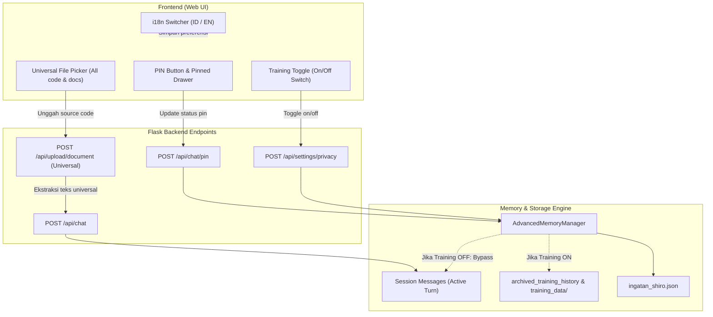
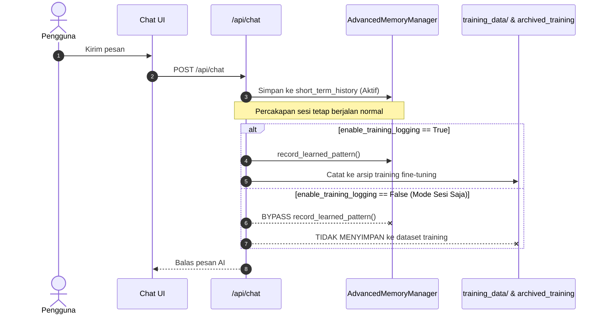

# RFD: Pembaruan Antarmuka & Manajemen Memori ShiroLLM (v2.5)

**Penulis:** Renku & Shiro Core Team  
**Target Modul:** `d:\Shiro-LLMA` (`shiro/document/`, `shiro/memory/`, `shiro/routes/`, `templates/`, `static/`)  
**Tujuan:** Mengintegrasikan sakelar bahasa UI (ID/EN), sakelar perekaman dataset training (On/Off), fitur sematkan pesan (Chat PIN), dan dukungan berkas universal (seluruh bahasa pemrograman & skrip).

---

## 1. Latar Belakang & Kebutuhan Pengguna

ShiroLLM saat ini memiliki antarmuka yang bersih dan responsif, namun pengguna membutuhkan 4 peningkatan penting untuk produktivitas harian dan privasi:

1. **Dukungan Dua Bahasa UI (Bahasa Indonesia & English):** Antarmuka saat ini sebagian besar tertulis dalam Bahasa Indonesia dengan beberapa istilah campur. Pengguna dapat memilih bahasa antarmuka secara instan dari menu Pengaturan tanpa harus memuat ulang halaman secara paksa.
2. **Kontrol Perekaman Data Training (On/Off Toggle):**
   - **Mode ON (Aktif):** Percakapan dicatat ke dalam `learned_patterns`, `archived_training_history`, dan diekspor ke format dataset fine-tuning (`training_data/` ShareGPT / Alpaca) saat sesi selesai/dihapus.
   - **Mode OFF (Nonaktif / Sesi Saja):** Shiro tetap mempertahankan ingatan multi-turn dalam sesi aktif agar percakapan tetap nyambung, namun **sama sekali tidak merekam atau mengarsipkan data ke dataset training permanen**. Ketika sesi ditutup atau dihapus, percakapan langsung musnah tanpa jejak di dataset.
3. **Fitur Sematkan Pesan (PIN Chat):** Pengguna dapat menyematkan (PIN) pesan penting (baik instruksi pengguna maupun jawaban AI) seperti pada ChatGPT/Claude. Pesan yang disematkan memiliki penanda visual dan dapat diakses cepat melalui panel pintasan Pinned Messages.
4. **Dukungan Ekstraksi Berkas & Kode Universal:** Tidak terbatas hanya pada dokumen kantor atau Python, Shiro harus mampu menerima dan mengekstrak teks dari seluruh format bahasa pemrograman (`.js`, `.ts`, `.py`, `.c`, `.cpp`, `.java`, `.go`, `.rs`, `.php`, `.sh`, `.ps1`, `.bat`, `.sql`, `.html`, `.css`, `.json`, `.yaml`, dll.) serta fallback otomatis untuk berkas teks murni apa pun.

---

## 2. Arsitektur Komponen



---

## 3. Rincian Rancang Bangun (Specification Details)

### 3.1. Fitur 1: UI Language Switcher (ID / EN)

#### Konsep Desain
- Menggunakan kamus translasi modular `i18n` berbasis JSON/Objek JavaScript di sisi klien (`static/i18n.js` atau terintegrasi langsung di `static/script.js`).
- Elemen HTML diberi atribut `data-i18n="key"` untuk teks innerHTML, dan `data-i18n-attr="placeholder:key_placeholder"` untuk atribut input.
- Ketika tombol bahasa (ID / EN) diklik, fungsi `setLanguage('en' | 'id')` langsung memperbarui seluruh teks UI secara instan dalam hitungan milidetik tanpa reload browser.
- Pilihan bahasa disimpan di `localStorage.getItem('shiro_lang')` dan dikirimkan ke preferensi profil pengguna di backend (`memory.user_profile["language"]`).

#### Cakupan Translasi Kamus
- **Sidebar:** Tombol Chat Baru, Riwayat Sesi, Pengaturan, Penanda Memori, Tombol Hapus.
- **Area Chat:** Salam sambutan Shiro, tombol aksi pesan (Salin, Edit, Buat Ulang, PIN), status eksekusi tool.
- **Komposer Input:** Placeholder pesan, tombol Berkas (`Berkas` / `Files`), Gambar (`Gambar` / `Images`), Kamera (`Kamera` / `Camera`), tombol Kirim / Berhenti.
- **Modal Pengaturan:** Tab Anda, Shiro, Model, API, Tema, Privasi; seluruh label form, placeholder, dan deskripsi bantuan.
- **Modal Berkas & Gambar:** Penampil dokumen, tombol unduh, buka tab baru, tombol tutup.

---

### 3.2. Fitur 2: Sakelar Perekaman Data Training (On/Off Toggle)

#### Permasalahan Saat Ini
Pada implementasi sekarang (`shiro/routes/chat.py` dan `shiro/memory/manager.py`), setiap giliran percakapan secara otomatis memanggil `memory.record_learned_pattern()` dan ketika sebuah sesi dihapus melalui `delete_session()`, seluruh pasangan percakapan secara paksa dicatat ke dalam `archived_training_history` dan diekspor ke folder `training_data/`.

#### Desain Solusi Baru
Menambahkan parameter konfigurasi:
`system_metadata["enable_training_logging"] = True / False` (Default: `True`).



#### Perilaku saat Sesi Dihapus (`delete_session`):
- **Jika `enable_training_logging == True`:** Seluruh riwayat sesi diarsipkan ke `archived_training_history` dan `training_data/` diekspor (seperti perilaku lama).
- **Jika `enable_training_logging == False`:** Sesi langsung dibersihkan dan dihapus dari memori **tanpa** mengekspor apa pun ke dataset training. Privasi pengguna terjamin 100%.

#### Antarmuka di Modal Pengaturan:
- Tab baru atau grup di Pengaturan: **"Privasi & Pembelajaran Model"** (`Privacy & Model Training`).
- Switch toggle modern:
  - Label: **"Rekam Percakapan untuk Training Model"** (`Save Conversations for Model Training`).
  - Keterangan Dinamis:
    - *Saat Aktif:* "Percakapan akan dipelajari dan disimpan ke arsip dataset fine-tuning untuk melatih model Shiro di masa depan."
    - *Saat Nonaktif:* "Mode privat aktif. Percakapan hanya disimpan sementara dalam sesi ini untuk konteks obrolan dan tidak akan pernah disimpan ke dataset training."

---

### 3.3. Fitur 3: Sistem Sematkan Pesan (PIN Chat)

#### Konsep Desain
Seperti pada ChatGPT, Claude, dan platform AI modern:
- Setiap pesan memiliki tombol **PIN** di baris aksi pesan (`msg-actions-bar`).
- Pengguna dapat menyematkan instruksi kunci, kode pemrograman penting, atau rangkuman penting agar tidak hilang atau tenggelam dalam obrolan panjang.

#### Struktur Data Pesan
Setiap objek pesan dalam `memory.short_term_history` dan `sessions_store[session_id]["messages"]` diperkaya dengan atribut:
```json
{
  "id": "msg-8f92a1bc",
  "role": "assistant",
  "content": "Ini adalah potongan konfigurasi Dockerfile...",
  "timestamp": "2026-10-16T21:00:00",
  "pinned": true,
  "pinned_at": "2026-10-16T21:05:00"
}
```

#### Alur Interaksi & Endpoint API
1. **API Endpoint:** `POST /api/chat/pin`
   - Payload: `{"session_id": "current", "message_id": "msg-8f92a1bc", "pinned": true}`
   - Respons: `{"success": true, "message_id": "...", "pinned": true, "pinned_count": 2}`
2. **Visual di Balon Chat:**
   - Pesan yang disematkan menampilkan ikon pin kecil di sudut atas gelembung atau aksen border halus (`pinned-bubble-glow`).
   - Tombol pin berubah status menjadi `active` (ikon pin terisi: `ph-push-pin-slash` untuk melepas pin).
3. **Laci Akses Cepat (Pinned Messages Drawer / Bar):**
   - Di bagian atas area chat (chat-header) terdapat tombol: `📌 Pesan Tersemat (X)` / `📌 Pinned (X)`.
   - Mengklik tombol ini akan membuka popover/drawer berisi daftar pesan yang disematkan. Mengklik salah satu cuplikan pesan akan otomatis menggulir (smooth scroll) ke pesan tersebut di dalam percakapan!

---

### 3.4. Fitur 4: Dukungan Berkas & Kode Universal (.js, .py, dll.)

#### Permasalahan Saat Ini
1. Tag input berkas dibatasi oleh atribut `accept`:
   `accept=".pdf,.docx,.doc,.txt,.md,.json,.csv,.py,.log,.html,.xml,.yaml,.yml"` (tidak ada `.js`, `.ts`, `.cpp`, `.c`, `.sh`, `.java`, dll.).
2. Variabel `SUPPORTED_EXTENSIONS` di `shiro/document/reader.py` hanya berisi 18 ekstensi.
3. Rute `upload_document()` di `shiro/routes/documents.py` menolak berkas jika ekstensinya tidak cocok.

#### Solusi Arsitektur

##### 1. Perluasan Ekstensi Komprehensif
```python
SUPPORTED_CODE_EXTENSIONS = {
    # Web & Scripting
    ".js", ".jsx", ".mjs", ".cjs", ".ts", ".tsx", ".vue", ".svelte",
    ".html", ".htm", ".css", ".scss", ".sass", ".less",
    # Backend & System Languages
    ".py", ".pyw", ".java", ".c", ".cpp", ".cc", ".cxx", ".h", ".hpp",
    ".cs", ".go", ".rs", ".php", ".rb", ".swift", ".kt", ".kts",
    ".scala", ".dart", ".lua", ".pl", ".pm", ".r",
    # Shell & DevOps
    ".sh", ".bash", ".zsh", ".ps1", ".psm1", ".bat", ".cmd", ".awk",
    ".dockerfile", "dockerfile", ".env", ".gitignore",
    # Data & Config
    ".json", ".jsonl", ".yaml", ".yml", ".toml", ".xml", ".csv",
    ".tsv", ".sql", ".ini", ".cfg", ".conf", ".properties",
    # Documents
    ".txt", ".md", ".markdown", ".log", ".rtf", ".pdf", ".docx", ".doc"
}
```

##### 2. Fallback Binary Detector Universal (Zero Rejection untuk Berkas Teks)
Jika ada berkas dengan ekstensi baru atau tanpa ekstensi (misalnya `Makefile`, `Dockerfile`, `.env`):
- Sistem memeriksa 4096 byte pertama berkas.
- Jika tidak mengandung byte biner `b'\x00'`, berkas tersebut **100% dipastikan berkas teks/kode**.
- Sistem langsung membaca isi teks dengan strategi multi-encoding fallback (`utf-8` -> `cp1252` -> `latin-1`).
- Hasilnya: **Semua berkas skrip dan kode dari bahasa pemrograman apa pun pasti bisa dibaca tanpa error!**

##### 3. Tampilan Kartu Berkas & Syntax Highlighting
- Pada kartu dokumen di antarmuka chat (`chat-doc-card`):
  - Ekstensi kode (`JS`, `TS`, `PY`, `CPP`, `SH`, dll.) mendapatkan badge warna khusus kode (`badge-code`).
  - Ketika diklik, modal `doc-viewer-modal` menampilkan teks dengan penomoran baris dan pewarnaan sintaks rapi menggunakan `highlight.js`.

---

## 4. Rencana Kerja Bertahap (Implementation Roadmap)

| Tahap | Fokus Pekerjaan | Berkas Terkait |
|---|---|---|
| **Tahap 1** | **Universal Code & File Support**<br>• Perluas `SUPPORTED_EXTENSIONS`<br>• Implementasi binary detection fallback di `reader.py`<br>• Perbarui rute upload di `documents.py`<br>• Perbarui `accept` file input & card styling di frontend | `shiro/document/reader.py`<br>`shiro/routes/documents.py`<br>`templates/index.html`<br>`static/script.js` |
| **Tahap 2** | **Sakelar Perekaman Training (On/Off)**<br>• Tambah setting `enable_training_logging` di `AdvancedMemoryManager`<br>• Penyesuaian bypass `record_learned_pattern` di `chat.py`<br>• Modifikasi `delete_session` agar hormati mode privat<br>• Endpoint API `GET/POST /api/settings/privacy`<br>• Toggle switch di Modal Pengaturan | `shiro/memory/manager.py`<br>`shiro/routes/chat.py`<br>`shiro/routes/admin.py`<br>`templates/index.html`<br>`static/script.js` |
| **Tahap 3** | **Sistem Sematkan Pesan (Chat PIN)**<br>• Tambah `id` & `pinned` pada struktur pesan memori<br>• Endpoint `POST /api/chat/pin`<br>• Tombol pin di `msg-actions-bar` (User & AI)<br>• Header Pinned Drawer untuk melompat ke pesan tersemat | `shiro/routes/chat.py`<br>`shiro/memory/manager.py`<br>`templates/index.html`<br>`static/script.js`<br>`static/style.css` |
| **Tahap 4** | **UI Language Switcher (ID / EN)**<br>• Bangun kamus translasi lengkap (ID & EN)<br>• Pasang atribut `data-i18n` pada seluruh template HTML<br>• Selector bahasa (ID / EN) di Settings modal & sidebar<br>• Transisi bahasa dinamis tanpa reload halaman | `static/i18n.js` (atau di `script.js`)<br>`templates/index.html`<br>`static/script.js`<br>`static/style.css` |
| **Tahap 5** | **Verifikasi & Uji Menyeluruh (Testing)**<br>• Uji upload berkas `.js`, `.py`, `.cpp`, `.sh`<br>• Uji PIN dan Unpin pesan serta lompat ke pesan<br>• Uji mode Training OFF (pastikan data tidak masuk `training_data/`)<br>• Uji pergantian bahasa ID <-> EN | Seluruh komponen |

---

## 5. Keputusan Desain yang Perlu Dikonfirmasi

1. **Letak Sakelar Bahasa (ID/EN):**  
   Apakah preferensi bahasa diletakkan di dalam modal Pengaturan (tab Tampilan/Umum) atau juga dilengkapi tombol pintasan bendera/kode bahasa kecil (🇮🇩 ID / 🇬🇧 EN) di sidebar/header agar bisa diganti dalam 1-klik? *(Rekomendasi: Keduanya tersedia).*
2. **Perilaku Sesi saat Training OFF:**  
   Saat Training OFF, percakapan tetap diingat selama 1 sesi aktif berjalan (agar AI tetap mengerti percakapan sebelumnya), namun tidak pernah disimpan ke arsip dataset training. Apakah ini sudah sesuai dengan yang diharapkan? *(Sesuai dengan deskripsi permintaan).*
3. **Batas Maksimal Karakter Berkas Kode:**  
   Batas ekstraksi teks berkas kode default adalah 12.000 karakter (~3.000 token) untuk menghemat konteks LLM. Jika file sangat panjang, Shiro akan mengambil bagian utama dan memberi tanda potong. Apakah batas ini sudah cukup ideal?
