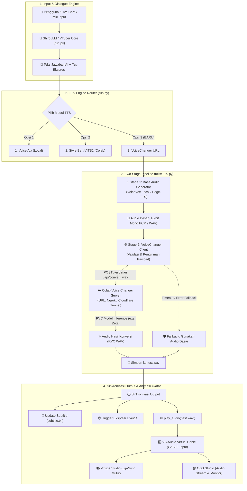

# 🎙️ Technical Blueprint: Integrasi Modul VoiceChanger URL (RVC) ke VTuber AI & ShiroLLM

| Informasi Dokumen | Detail |
| :--- | :--- |
| **Proyek** | Integrasi Modul Suara ke-3 (Realtime Voice Changer / RVC) pada VTuber AI & ShiroLLM |
| **Direktori Target** | `D:\Downloads\vtuber` (VTuber Core) & `d:\Shiro-LLMA` (ShiroLLM Engine) |
| **Infrastruktur Eksternal** | Google Colab GPU (A100/T4) via Tunneling (Ngrok / Cloudflare) |
| **Tujuan Utama** | Konversi otomatis *Text-to-Speech-to-RVC* hanya dengan memasukkan URL Server VoiceChanger |

---

## 1. Ringkasan Eksekutif & Konteks Sistem

### 1.1 Kondisi Saat Ini vs. Target Pengembangan
Saat ini, sistem VTuber (`D:\Downloads\vtuber\run.py`) hanya mendukung 2 opsi *Text-to-Speech* (TTS). Pembaruan ini menambahkan **Modul ke-3 (VoiceChanger URL)** yang memungkinkan pengguna cukup menempelkan (*paste*) tautan publik Ngrok/Cloudflare dari Google Colab untuk menghasilkan suara karakter kustom (seperti *Vestia Zeta*) lengkap dengan sinkronisasi gerak bibir (*lip-sync*) di VTube Studio.

| Modul | Nama Engine | Metode Pemrosesan | Beban Komputasi | Karakteristik Suara |
| :---: | :--- | :--- | :--- | :--- |
| **1** | **VoiceVox Engine** | Text $\rightarrow$ Audio (Lokal) | CPU / GPU Lokal (Port `50021`) | Suara anime standar (cepat & stabil) |
| **2** | **Style-Bert-VITS2** | Text $\rightarrow$ Audio (Cloud API) | Google Colab GPU (Gradio) | Ekspresif, bergantung pada model VITS2 |
| **3 (Baru)** | **VoiceChanger URL** | Text $\rightarrow$ Base TTS $\rightarrow$ RVC Audio | Hybrid (Base TTS + Colab GPU RVC) | **Suara karakter spesifik (RVC) dengan timbre akurat** |

### 1.2 Prinsip Arsitektur: *Two-Stage Audio Synthesis Pipeline*
> [!IMPORTANT]
> **Karakteristik Engine RVC (w-okada Voice Changer):**
> Voice Changer merupakan mesin **Audio-to-Audio** (*Voice Conversion*), bukan *Text-to-Speech* murni. Oleh karena itu, agar modul ini dapat menerima input berupa teks dari ShiroLLM, sistem harus bekerja menggunakan arsitektur **Two-Stage Audio Synthesis Pipeline**:
>
> $$\text{Teks Jawaban AI} \xrightarrow{\text{Stage 1}} \text{Base TTS Audio (WAV)} \xrightarrow{\text{Stage 2}} \text{VoiceChanger URL (RVC)} \xrightarrow{\text{Output}} \text{VTube Studio (Lip-Sync)}$$

---

## 2. Arsitektur Sistem & Alur Data (*End-to-End Pipeline*)

### 2.1 Diagram Alur Kerja Sistem



### 2.2 Urutan Eksekusi (*Execution Lifecycle*)
1. **Generasi Teks**: ShiroLLM memproses input pengguna dan menghasilkan teks balasan beserta tag emosi/ekspresi.
2. **Sintesis Suara Dasar (*Stage 1*)**: Modul `TTS.py` mengubah teks menjadi berkas suara dasar menggunakan *Base TTS* (`VoiceVox` lokal atau `Edge-TTS` sebagai alternatif ringan tanpa aplikasi tambahan).
3. **Konversi RVC (*Stage 2*)**: Audio dasar dikemas dan dikirim melalui jaringan HTTP ke URL VoiceChanger di Google Colab.
4. **Rekonstruksi & Validasi**: Respons audio dari Colab disusun kembali menjadi berkas `test.wav` yang valid (memiliki *header* RIFF WAV dan ukuran $> 1000\text{ byte}$).
5. **Sinkronisasi Penampilan**: Tepat setelah `test.wav` siap, sistem secara serentak memicu perubahan ekspresi wajah di VTube Studio, memperbarui berkas *subtitle* OBS, dan memutar suara melalui *Virtual Audio Cable*.

---

## 3. Spesifikasi Teknis & Desain Komponen

### 3.1 Konfigurasi Sistem (`config.py` & `.env`)
Menambahkan parameter konfigurasi agar URL VoiceChanger dan pengaturan suaranya tersimpan secara permanen di `.env`, sehingga pengguna tidak perlu mengetik ulang URL jika sesi tunnel masih sama.

**Variabel pada `.env`:**
```env
VOICE_CHANGER_URL=https://unsynthetically-proliferative-joey.ngrok-free.dev
VOICE_CHANGER_BASE_TTS=voicevox
VOICE_CHANGER_PITCH=0
VOICE_CHANGER_TIMEOUT=10
```

**Implementasi pada `D:\Downloads\vtuber\config.py`:**
```python
# Konfigurasi Modul 3: Voice Changer URL (RVC Colab Tunnel)
voice_changer_url = os.getenv("VOICE_CHANGER_URL", "").strip().rstrip("/")
voice_changer_base_tts = os.getenv("VOICE_CHANGER_BASE_TTS", "voicevox")  # Opsi: "voicevox" atau "edge_tts"
voice_changer_pitch = int(os.getenv("VOICE_CHANGER_PITCH", "0"))
voice_changer_timeout = int(os.getenv("VOICE_CHANGER_TIMEOUT", "10"))
```

### 3.2 Antarmuka Pemilihan Awal (`run.py`)
Menambahkan menu interaktif di terminal saat aplikasi dijalankan, dilengkapi fitur *auto-load* dari konfigurasi sebelumnya dan sanitasi URL otomatis (menghapus spasi atau garis miring berlebih di akhir URL).

**Tampilan Antarmuka CLI:**
```text
============================================================
Pilih TTS Engine:
  1. VoiceVox Engine (Default Local - Port 50021)
  2. Style-Bert-VITS2 Engine (Google Colab Gradio API)
  3. VoiceChanger URL (Text -> Base TTS -> RVC Colab)
============================================================
Select Engine TTS (1/2/3) [Default 1]: 3
Masukkan VoiceChanger URL (Ngrok / Cloudflare) [Tekan Enter untuk URL tersimpan]: https://unsynthetically-proliferative-joey.ngrok-free.dev
[TTS Engine] Mengecek koneksi ke server VoiceChanger...
[TTS Engine] VoiceChanger URL Aktif! Terhubung ke: https://unsynthetically-proliferative-joey.ngrok-free.dev
```

### 3.3 Desain Adapter pada `utils/TTS.py`
Menambahkan fungsi utama `voice_changer_tts(text)` dengan spesifikasi pemrosesan audio sebagai berikut:
* **Format Input RVC**: Audio dikonversi ke *16-bit Signed Integer PCM*, *Mono* ($1\text{ channel}$), dengan *Sample Rate* yang disesuaikan ($24000\text{ Hz}$ atau $48000\text{ Hz}$ mengikuti konfigurasi server w-okada).
* **Header Khusus Tunnel**: Menyertakan HTTP header `"ngrok-skip-browser-warning": "true"` pada setiap *request* agar tidak tertahan oleh halaman peringatan Ngrok gratis.

---

## 4. Strategi Komunikasi API ke Server Voice Changer

Terdapat dua pendekatan teknis untuk mengirim audio dari PC lokal ke server Voice Changer di Google Colab:

### Perbandingan Strategi Komunikasi

| Parameter | Strategi A: Native Endpoint `/test` (Direkomendasikan) | Strategi B: Custom Endpoint `/api/convert_wav` |
| :--- | :--- | :--- |
| **Perubahan di Colab** | **Tidak ada** (100% kompatibel dengan w-okada bawaan) | Perlu menyuntikkan *route* FastAPI baru di skrip Colab |
| **Format Payload** | JSON (`timestamp` + `buffer` Base64 Raw PCM 16-bit) | `multipart/form-data` (berkas `.wav` utuh) |
| **Format Respons** | JSON (`changedVoiceBase64` Raw PCM 16-bit) | File biner `audio/wav` langsung |
| **Penanganan Kalimat Panjang** | Perlu pemecahan *chunk* (tiap $0.5\text{ s}$ – $1.0\text{ s}$) & penggabungan ulang | Diproses sekaligus dalam satu kali *inference* |
| **Kapan Digunakan** | Saat ingin langsung pakai tanpa memodifikasi notebook Colab | Saat ingin latensi satu kali jalan untuk kalimat panjang |

### Detail Teknis Strategi A (Native `/test` Endpoint)
1. **Ekstraksi PCM**: Membaca berkas WAV dari *Base TTS*, mengubahnya ke *mono* dan melakukan *resampling* jika diperlukan, lalu mengambil *raw frames* PCM 16-bit tanpa *header* WAV.
2. **Pengiriman Request**:
   * **Endpoint**: `POST {VOICE_CHANGER_URL}/test`
   * **Payload JSON**:
     ```json
     {
       "timestamp": 1729050000,
       "buffer": "<Base64_Encoded_Raw_16bit_PCM>"
     }
     ```
3. **Rekonstruksi WAV**: Mengambil nilai `changedVoiceBase64` dari respons JSON, melakukan *decode* Base64 kembali menjadi *bytes* PCM, lalu membungkusnya dengan *header* RIFF WAV menggunakan modul `wave` bawaan Python untuk disimpan sebagai `test.wav`.

---

## 5. Rencana Implementasi Bertahap (*Actionable Roadmap*)

### Fase 1: Persiapan Konfigurasi & Environment
* **Berkas Target**: `D:\Downloads\vtuber\.env` & `D:\Downloads\vtuber\config.py`
* **Tindakan**:
  * Menambahkan variabel `VOICE_CHANGER_URL`, `VOICE_CHANGER_BASE_TTS`, dan `VOICE_CHANGER_TIMEOUT`.
  * Membuat fungsi utilitas untuk menyimpan pembaruan URL secara otomatis ke `.env` saat pengguna memasukkan link baru di terminal.
* **Indikator Selesai (*DoD*)**: Variabel terbaca dengan benar oleh `config.py` tanpa error.

### Fase 2: Pengembangan Core Adapter RVC pada `TTS.py`
* **Berkas Target**: `D:\Downloads\vtuber\utils\TTS.py`
* **Tindakan**:
  * Menambahkan *state* pemilihan engine `"voice_changer"` pada fungsi `set_tts_engine()`.
  * Mengimplementasikan fungsi pembantu `_generate_base_wav(text)` (mendukung VoiceVox lokal atau Edge-TTS).
  * Mengimplementasikan fungsi `_convert_via_voice_changer(input_wav_path, output_wav_path)` dengan dukungan *Base64 PCM framing* ke endpoint `/test` dan *header* bypass Ngrok.
  * Mengintegrasikan *fallback mechanism* apabila server Colab tidak merespons.
* **Indikator Selesai (*DoD*)**: Pemanggilan fungsi `voice_changer_tts("Halo semuanya")` berhasil menghasilkan berkas `test.wav` bersuara model RVC.

### Fase 3: Integrasi Menu Startup pada `run.py`
* **Berkas Target**: `D:\Downloads\vtuber\run.py`
* **Tindakan**:
  * Menambahkan pilihan nomor `3` pada saat inisialisasi program.
  * Menambahkan *health-check ping* (`GET {url}/info` atau pengecekan status HTTP) saat URL dimasukkan untuk memastikan tunnel Colab sedang aktif.
* **Indikator Selesai (*DoD*)**: Pengguna dapat memilih opsi 3 dari terminal, memasukkan URL Ngrok/Cloudflare, dan melihat status koneksi berhasil.

### Fase 4: Integrasi Langsung ke ShiroLLM (Opsional / Standalone Mode)
* **Berkas Target**: `d:\Shiro-LLMA\web.py` atau modul klien API ShiroLLM
* **Tindakan**:
  * Menghubungkan *endpoint* output teks ShiroLLM agar dapat memicu modul `voice_changer_tts` secara langsung ketika diuji tanpa *loop* penuh `run.py`.
* **Indikator Selesai (*DoD*)**: Respons chat dari Web UI ShiroLLM dapat langsung memutar suara RVC.

### Fase 5: Pengujian Kualitas & Kalibrasi Sinkronisasi
* **Target Pengujian**: Alur penuh ShiroLLM $\rightarrow$ Colab RVC $\rightarrow$ VTube Studio
* **Tindakan**:
  * Menguji kalimat pendek ($< 5\text{ kata}$) dan kalimat panjang ($> 20\text{ kata}$).
  * Menyesuaikan *sample rate* dan *pitch offset* agar suara karakter (misal: Vestia Zeta) terdengar jernih tanpa distorsi atau *chipmunk effect*.
  * Memastikan gerak bibir (*lip-sync*) di VTube Studio sinkron dengan keluarnya suara dan teks *subtitle*.

---

## 6. Protokol Penanganan Kesalahan (*Resilience & Fallback*)

Untuk menjamin sesi *live streaming* atau interaksi VTuber tidak macet (*freeze*) akibat kendala jaringan cloud, sistem dilengkapi tiga lapis pengaman:

1. **Auto-Fallback ke Base TTS saat Gagal Koneksi / Timeout**:
   * Apabila request ke `VOICE_CHANGER_URL` melebihi batas waktu ($> 10\text{ detik}$), mengembalikan kode error HTTP ($502\text{ Bad Gateway}$ / $404\text{ Not Found}$ karena Colab terputus), atau gagal terhubung, sistem otomatis menggunakan audio dari *Base TTS* (`VoiceVox` / `Edge-TTS`).
   * Log peringatan ditampilkan di konsol (`[WARNING] RVC Colab tidak merespons, memutar suara Base TTS...`), namun VTuber tetap berbicara tanpa keheningan (*dead air*).
2. **Validasi Integritas Berkas Audio**:
   * Sebelum memanggil `play_audio("test.wav")`, sistem memeriksa apakah berkas ada, berukuran $> 1000\text{ byte}$, dan memiliki *frame rate* audio yang valid agar *library* `sounddevice` / `winsound` tidak mengalami *crash*.
3. **Penahanan Sinkronisasi Ekspresi & Subtitle (*Deferred Sync*)**:
   * Mengingat proses konversi RVC di cloud membutuhkan waktu tambahan sekitar $1\text{ s}$ – $3\text{ s}$, pemicu ekspresi wajah (`trigger_expression`) dan pembaruan teks (`generate_subtitle`) **ditahan hingga konversi audio RVC selesai**, tepat sebelum `play_audio()` dijalankan. Hal ini mencegah avatar berubah ekspresi atau menampilkan teks terlalu cepat sebelum suaranya terdengar.