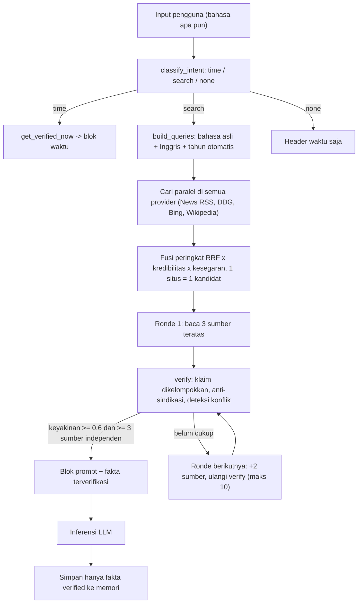

# Rencana Implementasi v2: Real-Time Web Intelligence Multibahasa dengan Verifikasi Multi-Sumber

> [!IMPORTANT]
> Perubahan dari v1: (1) deteksi intent dan pembuatan kueri **multibahasa** (id, en, es, fr, de, pt, ja, ko, zh, ru, ar), (2) pencarian **adaptif 3 sampai 10 sumber independen**, (3) **verifikasi silang** antar sumber sebelum menjadi fakta, (4) hanya fakta terverifikasi yang boleh masuk memori jangka panjang.

Implementasi: `shiro/web/realtime_intel.py`. Tes: `tests/test_realtime_intel.py` (11 tes, berjalan offline).

---

## 1. Masalah v1 yang diperbaiki

| Masalah di v1 | Perbaikan di v2 |
|---|---|
| Sinyal pemicu hanya bahasa Indonesia | Leksikon per bahasa + deteksi bahasa (skrip dan stopword). Bahasa pengguna selalu dicek bersama `en` dan `id` karena pengguna sering campur bahasa. Bahasa baru ditambah lewat `register_language()` tanpa mengubah kode inti |
| Kueri Indonesia saja, hasil global tidak terjangkau | `build_queries()` membuat varian bahasa asli dan varian Inggris (kamus id-en bawaan, atau fungsi `llm_rewrite` memakai Qwen untuk bahasa lain) |
| Satu sumber dianggap cukup | Minimal 3 sumber independen dibaca, eskalasi +2 sumber per ronde sampai keyakinan cukup, maksimal 10 |
| Salinan berita agensi dianggap banyak sumber | Dokumen dengan isi hampir sama dan angka identik dikelompokkan sebagai 1 sumber (anti-sindikasi) |
| Sumber berkualitas rendah setara sumber resmi | Bobot kredibilitas domain (resmi/berita besar naik, forum/blog/media sosial turun) dan bobot kesegaran tanggal |
| Hasil pencarian langsung disimpan ke memori | Hanya fakta berstatus `verified` yang disimpan; `single` dan `conflict` tidak |
| Jam lokal container bisa meleset | `get_verified_now()` membandingkan jam sistem dengan header `Date` beberapa server, median dipakai jika selisih > 120 detik |

---

## 2. Arsitektur

---

## 3. Algoritma per komponen

### 3.1 Intent multibahasa (`classify_intent`)
Skor = sinyal temporal (maks 3) + tren/peringkat (maks 2) + inkuiri (maks 1,5) + tahun berjalan (1,5) + pertanyaan pemegang jabatan (2,5) + perintah eksplisit (3). Skor >= 2,5 berarti `search`. Sinyal personal ("aku capek", "I'm so tired", "疲れた", ...) mengurangi 3 poin sehingga curhat tidak memicu pencarian. Pertanyaan waktu murni (hari/tanggal/jam) menghasilkan `time` tanpa pencarian web.

### 3.2 Kueri (`build_queries`)
1. Buang kata pengantar sesuai bahasa (tolong, please, お願い, пожалуйста, dst.).
2. Ganti "tahun ini / this year / 今年 / 올해 / ..." dengan tahun berjalan; tambahkan tahun jika ada kata "terbaru / latest / 最新" tanpa tahun.
3. Tambah varian Inggris agar sumber global ikut terjangkau.
4. Parameter `lang` diteruskan ke tiap provider (untuk `hl=`/region).

### 3.3 Pencarian multi-sumber adaptif (`research`)
- Standar: 3 sumber independen. Eskalasi: +2 sumber per ronde. Batas keras: 10 sumber independen (dan maks 20 percobaan fetch).
- Berhenti lebih awal jika sudah >= 3 sumber independen **dan** keyakinan >= 0.6.
- Satu domain hanya dihitung satu kali; kegagalan provider atau fetch diabaikan tanpa menjatuhkan alur.
- Halaman yang gagal dibaca memakai cuplikan, dengan bobot setengah dan tidak dihitung sebagai sumber independen.

### 3.4 Verifikasi silang (`verify`)
1. Ambil kalimat relevan dari tiap dokumen (tumpang tindih token dengan topik; CJK memakai bigram).
2. Kelompokkan kalimat yang mengklaim hal sama.
3. Status per kelompok:
   - `verified`: didukung >= 2 sumber independen tanpa pertentangan angka.
   - `conflict`: angka berbeda antar sumber independen (contoh harga 15,9 juta vs 18,9 juta). Dilaporkan ke LLM sebagai konflik, tidak disimpan.
   - `single`: hanya 1 sumber. Boleh disebut dengan atribusi "menurut <sumber>", tidak disimpan.
4. Untuk pertanyaan daftar (anime populer, rekomendasi game): nama/judul yang muncul di >= 2 sumber independen dilaporkan sebagai entitas terkonfirmasi.
5. Keyakinan akhir: rata-rata 3 fakta terverifikasi terbaik. Jika tidak ada fakta terverifikasi, keyakinan dibatasi 0.4 dan prompt menginstruksikan LLM untuk mengatakan "belum bisa dipastikan".

### 3.5 Konteks waktu di setiap giliran
`time_prompt_block()` menyuntikkan hari, tanggal, jam WIB/WITA/WIT/JST ke system prompt di setiap giliran, tanpa pencarian.

### 3.6 Memori (`ResearchResult.storable_facts()`)
Hanya fakta `verified` (beserta daftar URL sumber dan tanggal akses) dikirim ke `integrate_web_knowledge()` lalu ke `ingatan_shiro.json` dan dataset training. Ini mencegah informasi salah dari satu sumber tercemar ke memori jangka panjang.

---

## 4. Integrasi ke kode Shiro yang sudah ada

1. Salin `realtime_intel.py` ke `shiro/web/`.
2. Bungkus fungsi pencarian lama dengan `wrap_search_fn(...)` (satu entri per mesin) dan sediakan `fetcher(url) -> str` dari `open_and_read_webpage`.
3. Di `inference.py` (jalur `get_shiro_reply` dan `stream_shiro_reply`): panggil `classify_intent`, lalu `research(...)` bila `kind == "search"`, tambahkan `res.prompt_block` ke system prompt. Contoh lengkap ada di akhir `realtime_intel.py`.
4. Ganti `detect_agent_intent` bagian `time_triggers` dengan `classify_intent`.
5. Windows: `pip install tzdata` agar zona waktu IANA tersedia (ada fallback offset tetap).

---

## 5. Parameter yang bisa disetel (`ResearchConfig`)

| Parameter | Default | Fungsi |
|---|---|---|
| `default_sources` | 3 | Sumber independen minimum |
| `max_sources` | 10 | Batas atas sumber independen |
| `batch_size` | 2 | Tambahan sumber per ronde eskalasi |
| `min_agree` | 2 | Sumber independen agar fakta `verified` |
| `min_confidence` | 0.6 | Ambang berhenti mencari |
| `cluster_overlap` | 0.55 | Kemiripan klaim; naikkan jika terlalu banyak klaim tergabung |
| `credibility` | tabel bawaan | Bobot per domain; tambahkan situs berita lokal tepercaya |

---

## 6. Pengujian

`python tests/test_realtime_intel.py` mencakup: intent 12 bahasa, curhat tidak memicu pencarian, injeksi tahun, varian Inggris via LLM, koreksi jam server, eskalasi sumber saat sumber awal tidak cocok, salinan sindikasi dihitung 1 sumber, konflik harga terdeteksi dan tidak disimpan, tanpa hasil, dan provider yang error.

## 7. Batasan yang perlu diketahui

- Verifikasi bersifat heuristik (kemiripan token dan angka), bukan pemahaman semantik penuh. Kalimat yang sama maknanya tetapi beda sekali kata-katanya bisa tidak terkelompok, sehingga hanya berstatus `single`. Itu gagal ke arah aman (tidak disimpan).
- Deteksi konflik hanya untuk perbedaan angka. Konflik non-numerik (nama berbeda) perlu pemeriksaan LLM tambahan jika diinginkan.
- Kualitas akhir bergantung pada kualitas teks dari `fetcher` (harus teks artikel bersih, bukan HTML mentah).
- Tabel kredibilitas domain perlu disesuaikan dengan sumber yang Anda percaya.
