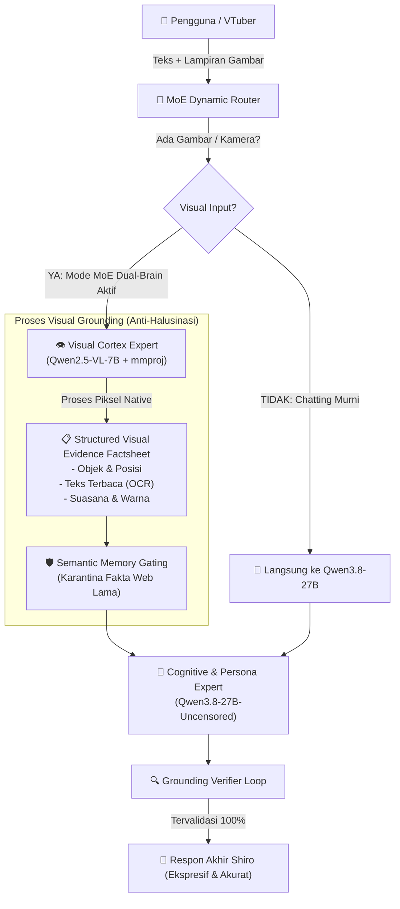

# 🧠 Blueprint Arsitektur Modular MoE Dual-Brain & Rencana Penuntasan Halusinasi Shiro AI

Dokumen perencanaan arsitektural (*Planning Specification*) untuk memisahkan dan menghubungkan kapabilitas model secara modular menggunakan pendekatan **System-Level Mixture of Experts (MoE)**:
- **Visual Cortex Expert**: `Qwen2.5-VL-7B-Instruct` (Observasi multimodal, visual grounding, OCR, inspeksi UI/gambar).
- **Cognitive & Dialogue Expert**: `Qwen3.8-27B-Uncensored` (Penalaran logika mendalam, kepribadian Shiro, uncensored conversation, penulisan kode).

Sistem ini dirancang **modular dan on-demand**—kedua model hanya digabungkan saat diperintahkan atau saat ada input multimodal yang memerlukan koordinasi antar-otak, tanpa mengganggu performa dan kecepatan mode single-model bawaan.

---

## 1. Audit Seluruh Model & Kapabilitas (Model Inventory)

Berdasarkan hasil pemindaian direktori `model/`, berkas konfigurasi `model_config.json`, dan skrip `download_model.py`:

| Identifikasi Model | Ukuran | Arsitektur | Kategori | Kebutuhan VRAM | Peran Strategis dalam MoE |
|---|---|---|---|---|---|
| **`Qwen2.5-VL-7B-Instruct`** (+ `mmproj-F16.gguf`) | ~5.6 GB + 1.4 GB | Qwen2.5-VL (Vision) | Multimodal Sejati | ~7.2 GB (Full GPU) | **Visual Cortex Expert**: Membaca gambar, OCR teks, mengenali UI, poster, foto, webcam. |
| **`Qwen_Qwen2.5-VL-32B-Instruct`** (+ `mmproj-f16.gguf`) | ~19.8 GB + 1.8 GB | Qwen2.5-VL (Vision) | Multimodal Heavyweight | ~23.5 GB (A100) | **Ultra Vision Expert**: Opsi alternatif untuk analisis gambar resolusi ultra-tinggi & video panjang. |
| **`Qwen3.8-27B-Uncensored`** (`Q4_K_M`) | ~16.8 GB | Qwen3.8 (LLM Teks) | Cognitive / Dialogue | ~18.5 GB (Full GPU) | **Cognitive & Persona Engine**: Penalaran mendalam, kepribadian Shiro, dialog tanpa filter, coding. |
| **`Qwen3-32B`** (`Q4_K_M`) | ~19.8 GB | Qwen3 (LLM Teks) | Pure Reasoning | ~21.5 GB (Full GPU) | **Analytical Engine**: Khusus pemecahan masalah matematika/analisis data kompleks. |
| **`Qwen2.5-7B-Instruct`** (`Q5_K_M`) | ~5.4 GB | Qwen2.5 (LLM Teks) | Balanced LLM | ~6.5 GB (T4 GPU) | **Lightweight Chat fallback**: Chatting cepat jika resource VRAM terbatas. |
| **`Llama-3.2-3B-Instruct-uncensored`** (`Q6_K`) | ~2.9 GB | Llama-3.2 (LLM Teks) | Ultra-Lightweight | ~3.8 GB (T4/CPU) | **MoE Fast Router / Verifier**: Mengklasifikasi intent & validasi halusinasi. |
| **`Qwen3-4B`** (`Q4_K_M`) | ~2.5 GB | Qwen3 (LLM Teks) | Local Default | ~3.2 GB (CPU/GPU) | **Local Fallback**: Berjalan stabil di PC tanpa kartu grafis dedicated. |
| **`Lumimaid-v0.2-8B`** (`Q5_K_M`) | ~5.7 GB | Llama-3 (LLM Teks) | Roleplay Specialist | ~7.0 GB (T4 GPU) | **Creative Roleplay Expert**: Variasi kepribadian interaktif alternatif. |

---

## 2. Analisis Akar Masalah Halusinasi (Hallucination Root Causes)

Sebelum membangun arsitektur MoE, berikut adalah 3 penyebab utama terjadinya halusinasi pada pengujian sebelumnya:

```
[Input Pengguna: Gambar Baru + "shiro coba lihat gambar ini"]
                           │
       ┌───────────────────┴───────────────────┐
       ▼                                       ▼
[Masalah 1: Vision Blindness]          [Masalah 2: Memory Contamination]
Model 27B adalah teks murni,           82 Fakta lama dimasukkan ke prompt
tidak menerima sinyal piksel           (termasuk situs web cosplaytele/nekopoi
(vision projector tidak cocok).        dari percakapan sebelumnya).
       │                                       │
       └───────────────────┬───────────────────┘
                           ▼
               [HASIL: HALUSINASI TOTAL]
Model menebak gambar baru adalah situs web dari masa lalu
karena tidak ada bukti visual valid yang membatasi imajinasinya.
```

1. **Vision Blindness & Missing Evidence Anchor**:
   Model teks murni tidak memiliki representasi visual internal. Tanpa ringkasan fakta visual yang objektif, model mengandalkan asosiasi terdekat dari prompt teks umum seperti *"coba lihat ini"*.
2. **Memory Pollution (Cross-Turn Bleeding)**:
   Modul memori sebelumnya mengambil 5 fakta teratas secara membabi buta tanpa semantic similarity gating. Fakta URL situs web masa lalu masuk ke prompt percakapan baru.
3. **Unchecked Generation Loop**:
   Tidak ada layer verifikasi mandiri (*grounding check*) untuk memastikan bahwa output teks yang dihasilkan model benar-benar didukung oleh fakta pada gambar yang dilampirkan saat ini.

---

## 3. Desain Arsitektur Dual-Brain MoE (System-Level Mixture of Experts)

### A. Mengapa Pendekatan System-Level MoE?
Penggabungan bobot model secara fisik (*weight merging / SLERP*) antara `Qwen2.5-VL-7B` dan `Qwen3.8-27B` **tidak dimungkinkan** karena perbedaan dimensi embedding, jumlah layer transformer, dan struktur arsitektur vision encoder. 

Solusi standar industri adalah **System-Level MoE (Modular Orchestration)**:
Setiap model berjalan sebagai spesialis independen (*expert node*), dikoordinasikan oleh **Brain Orchestrator** melalui kontrak data terstruktur (*Evidence Contract*).



---

## 4. Mekanisme Komunikasi Antar-Otak: *Visual Evidence Contract*

Ketika mode MoE aktif, `Qwen2.5-VL-7B` bertugas sebagai analis mata objektif dan menghasilkan **Evidence Contract JSON** yang dikunci ke dalam prompt `Qwen3.8-27B`:

```json
{
  "visual_ground_truth": {
    "is_webpage_or_url": false,
    "primary_subject": "Banner / Poster 'PROJECT SHIRO AI v2'",
    "detected_texts": [
      "PROJECT SHIRO AI v2",
      "Japanese & Indonesian Translation AI",
      "ISSELOTAKU DESU",
      "Renn-devBI"
    ],
    "visual_details": {
      "theme": "Dark mode dengan aksen ungu, neon, dan biru",
      "icons": ["YouTube (ISSELOTAKU DESU)", "GitHub (Renn-devBI)"],
      "composition": "Desain logo digital futuristik"
    }
  },
  "anti_hallucination_directives": [
    "Dilarang menyebutkan cosplaytele atau nekopoi.",
    "Gambar ini BUKAN browser web atau tangkapan layar browsing."
  ]
}
```

Prompt yang diterima oleh `Qwen3.8-27B` diformat sedemikian rupa sehingga model memiliki **jangkar realitas visual absolut**:

```text
[OBSERVASI MATA VISUAL SHIRO (FAKTA NYATA DARI PIKSEL)]:
- Objek Utama: Banner Project Shiro AI v2
- Teks yang Terbaca Jelas: "PROJECT SHIRO AI v2", "Japanese & Indonesian Translation AI", "ISSELOTAKU DESU", "Renn-devBI"
- Suasana Visual: Tampilan poster bernuansa neon sci-fi gelap dengan ikon YouTube dan GitHub.

[PANDUAN PERSONA & ANTI-HALUSINASI]:
Kamu melihat gambar di atas dengan mata kepalamu sendiri. Ceritakan dan bahas gambar ini dengan gaya manja, ceria, dan cerdas khas Shiro. JANGAN PERNAH mengaitkan gambar ini dengan situs web atau link di luar apa yang tercatat di atas.
```

---

## 5. Mode Eksekusi Modular & Manajemen VRAM (On-Demand Options)

Fitur penggabungan ini dibuat **on-demand** dengan 3 mode operasional yang dapat diganti melalui konfigurasi atau perintah chat:

### Mode 1: `single` (Default Standalone Mode)
- Menjalankan satu model aktif tunggal (misal `Qwen3.8-27B` saja untuk chatting super cepat atau `Qwen2.5-VL-7B` saja untuk vision murni).
- Jika ada gambar di mode teks, sistem menggunakan fallback OCR GPU lokal (`EasyOCR`) yang hemat memori.
- **Kebutuhan VRAM**: 16.8 GB (A100) atau 5.6 GB (T4).

### Mode 2: `dual_brain_concurrent` (MoE Berdampingan - Rekomendasi A100 GPU)
- `Qwen2.5-VL-7B` dan `Qwen3.8-27B` dimuat secara bersamaan di GPU VRAM.
- **Kalkulasi VRAM di Google Colab A100 (40 GB VRAM)**:
  - `Qwen3.8-27B` (`Q4_K_M`): ~16.8 GB
  - `Qwen2.5-VL-7B` (`Q4_K_M` + `mmproj`): ~7.0 GB
  - KV-Cache Konteks Gabungan (32K context): ~4.5 GB
  - **Total Penggunaan VRAM**: **~28.3 GB / 40 GB** *(Masih tersisa 11.7 GB VRAM aman dari Out of Memory)*.
- **Kecepatan**: Sangat instan karena kedua model sudah *warm* di memori.

### Mode 3: `dual_brain_swap` (Sequential VRAM Swapping - Rekomendasi GPU T4 16GB)
- Jika berjalan di GPU 16GB (seperti Colab T4 atau RTX 4070/4080 16GB):
  1. Saat ada gambar masuk, `Qwen2.5-VL-7B` aktif mengekstrak fakta visual (~2 detik).
  2. Hasil ekstraksi disimpan ke RAM sistem.
  3. LLM teks (`Qwen3.8-27B` via offload CPU/GPU atau model 7B/8B) menghasilkan balasan akhir Shiro.
  4. Mencegah Crash OOM di kartu grafis hemat daya.

---

## 6. Protokol Anti-Halusinasi Memori (*Semantic Gating*)

Untuk memastikan 82+ fakta di `ingatan_shiro.json` tidak mengotori persepsi model saat melihat gambar:

1. **Query-Context Similarity Filter**:
   Fakta memori masa lalu hanya diizinkan masuk ke prompt jika memiliki relevansi semantik langsung terhadap pesan pengguna saat ini.
2. **Visual Quarantine Rule**:
   Saat giliran pesan memuat gambar baru, fakta-fakta masa lalu yang berlabel `web_browsing`, `url_history`, atau entitas situs web otomatis **dikarantina** (dinonaktifkan sementara) pada giliran tersebut.
3. **Temporal Recency Separation**:
   Pemisahan yang jelas di prompt antara:
   - *Kondisi Detik Ini* (Real-time Attachment).
   - *Riwayat Masa Lalu* (Episodic Memory Archive).

---

## 7. Rencana Tahapan Implementasi (Implementation Roadmap)

| Tahap | Modul Target | Aksi Spesifik | Status |
|---|---|---|---|
| **Fase 1** | `shiro/models.py` & `download_model.py` | Menambahkan definisi model `vl-32b` dan konfigurasi parameter VRAM dual-brain. | Siap Dikerjakan |
| **Fase 2** | `shiro/agent/moe_router.py` (Baru) | Membuat modul orchestrator MoE yang mampu mengelola multi-instance `Llama` (Visual Expert + Cognitive Expert). | Siap Dikerjakan |
| **Fase 3** | `shiro/pipeline/inference.py` | Mengintegrasikan pipeline: `Input` -> `Visual Extraction` -> `Evidence Contract` -> `Dialogue Synthesis`. | Siap Dikerjakan |
| **Fase 4** | `shiro/memory/manager.py` | Memperbarui filter fakta dengan *Semantic Relevancy Gating* dan karantina entitas web saat gambar dilampirkan. | Siap Dikerjakan |
| **Fase 5** | Web UI & API Settings | Menambahkan saklar on-demand di Pengaturan Web UI: *"Mode MoE Dual-Brain (Vision + Chat)"* dengan opsi `Otomatis`, `Aktif`, dan `Nonaktif`. | Siap Dikerjakan |

---

## 8. Verifikasi & Tolok Ukur Keberhasilan (Acceptance Criteria)

1. **Uji Citra Nyata**:
   Saat pengguna mengirimkan gambar banner `PROJECT SHIRO AI v2`, Shiro **wajib** menyebutkan teks `"PROJECT SHIRO AI v2"`, pengembang `"Renn-devBI"`, dan dilarang keras menyebutkan nama domain/situs web dari sesi lama.
2. **Konsistensi Persona**:
   Meskipun fakta visual dianalisis oleh `Qwen2.5-VL-7B`, respon akhir pengguna tetap memiliki karakter adik Shiro yang ekspresif, hangat, dan cerdas berkat generasi dari `Qwen3.8-27B`.
3. **Stabilitas VRAM**:
   Pada pengujian Colab A100, penggunaan VRAM stabil di bawah 32 GB tanpa lonjakan memori tak terduga.
4. **On-Demand Flexibility**:
   Pengguna dapat mematikan atau menyalakan integrasi model kapan saja tanpa perlu restart server jika menggunakan mode swapped atau concurrent.
